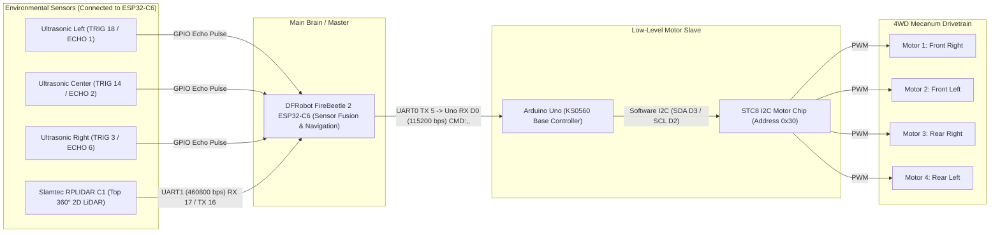
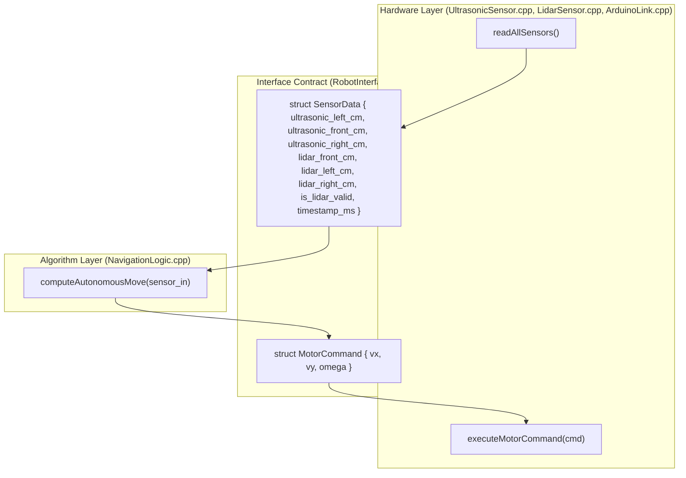
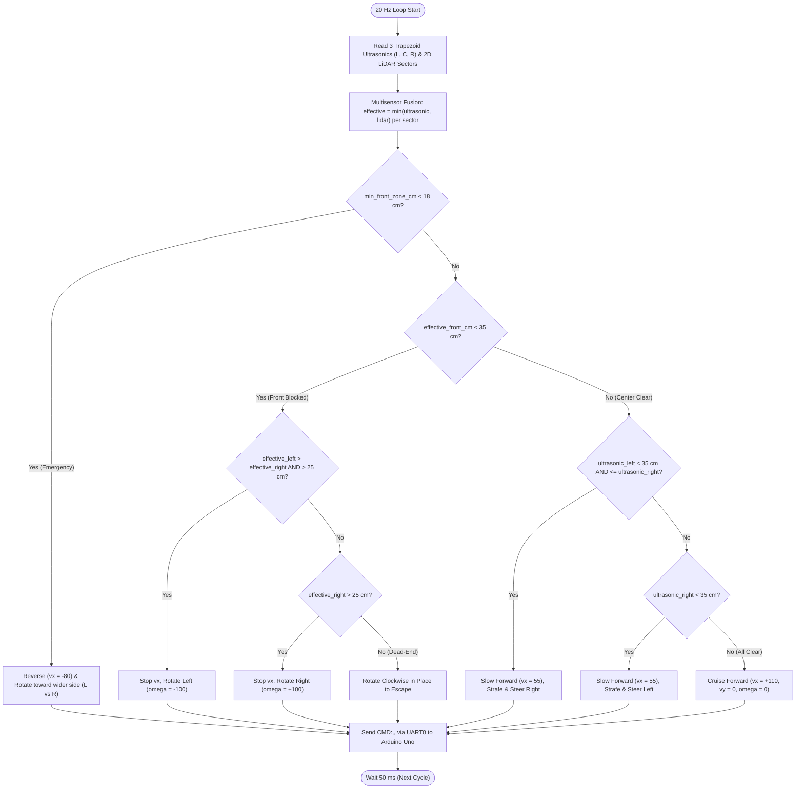

# System Architecture & Decision Flowcharts

This document provides the **System Block Diagrams** (required for **Milestone 1** and **Milestone 6**) and the **Autonomous Collision-Avoidance Flowchart** (required for **Milestone 4** and **Milestone 6**).

---

## 1. Hardware System Block Diagram (ESP32-C6 Main Brain + Arduino Motor Slave)

Our robot uses a **Master–Slave Dual-MCU architecture** over UART:
- The **DFRobot FireBeetle 2 ESP32-C6** reads all environmental sensors (**3 front trapezoid HC-SR04 Ultrasonic sensors** + top-mounted **Slamtec RPLIDAR C1**), executes multisensor collision avoidance, and sends motion commands over UART.
- The **Arduino Uno** receives UART motion commands (`115200` bps) on Hardware `Serial` (`D0`/`D1`), computes 4WD Mecanum wheel speeds, and drives the onboard **STC8 I2C motor chip** (`0x30`).

### Purpose of Each Main Component (Milestone 1 Deliverable)

| Component | Role & Purpose |
| :--- | :--- |
| **DFRobot FireBeetle 2 ESP32-C6 (Main Brain)** | High-speed RISC-V microcontroller that polls all 3 ultrasonic sensors and the RPLIDAR C1, fuses their measurements, runs the autonomous navigation algorithm, and sends velocity commands to the Arduino Uno over UART0. |
| **3x Front HC-SR04 Ultrasonic Sensors (Trapezoid Layout)** | Mounted across the front bumper in a trapezoid (Left-angled, Center-forward, Right-angled) to cover forward and diagonal blind zones and reliably detect close-range or optically transparent obstacles (e.g., glass). |
| **Slamtec RPLIDAR C1 (2D LiDAR)** | Top-mounted $360^\circ$ laser scanner (`460800` bps UART1) providing wide-angle directional clearances (Front, Left, Right) and detecting thin obstacles outside ultrasonic beam cones. |
| **Arduino Uno (Motor Controller Slave)** | Receives ASCII velocity commands (`CMD:<vx>,<vy>,<omega>\n` or `STOP\n`) over Hardware UART (`D0`/`D1`), computes 4WD Mecanum inverse kinematics, enforces a `500 ms` safety watchdog, and drives the STC8 chip. |
| **STC8 Motor Driver Electronics (`0x30`)** | Onboard motor co-processor on the Keyestudio KS0560 expansion board generating PWM and H-bridge direction signals for all 4 DC motors via software I2C (`D3 SDA` / `D2 SCL`). |
| **Keyestudio KS0560 Chassis & 4WD Mecanum Wheels** | Omnidirectional drivetrain supporting forward, backward, turning, lateral strafing, and in-place rotation. |

---

## 2. Software Architecture & Layer Separation (ESP32-C6)

Inside [`lib/`](../lib/) and [`src/ESP32_Brain/`](../src/ESP32_Brain/), the ESP32-C6 firmware is decoupled via [`lib/RobotInterface/RobotInterface.h`](../lib/RobotInterface/RobotInterface.h):

---

## 3. Inter-MCU UART Communication Protocol (`ESP32-C6 -> Arduino Uno`)

The **FireBeetle 2 ESP32-C6** (`UART0`, `TX = GPIO 5`, `RX = GPIO 4`) transmits newline-terminated ASCII packets at `115200` bps to the **Arduino Uno** (`Hardware Serial`, `D0 RX / D1 TX`):

| Packet Format | Example | Frequency | Description |
| :--- | :--- | :---: | :--- |
| `CMD:<vx>,<vy>,<omega>\n` | `CMD:110.0,0.0,0.0\n` | $20\text{ Hz}$ | Sets target Mecanum body velocity (`-255.0` to `+255.0`). |
| `STOP\n` | `STOP\n` | On demand | Immediate stop of all four DC motors. |

> **Safety Watchdog:** If the Arduino Uno receives no valid `CMD:` packet for more than `500 ms` (`COMMAND_TIMEOUT_MS`), it automatically stops all motors.

---

## 4. Autonomous Collision-Avoidance Flowchart (Milestones 4 & 6)

Below is the 5-stage decision cascade implemented in [`lib/NavigationLogic/NavigationLogic.cpp`](../lib/NavigationLogic/NavigationLogic.cpp):

